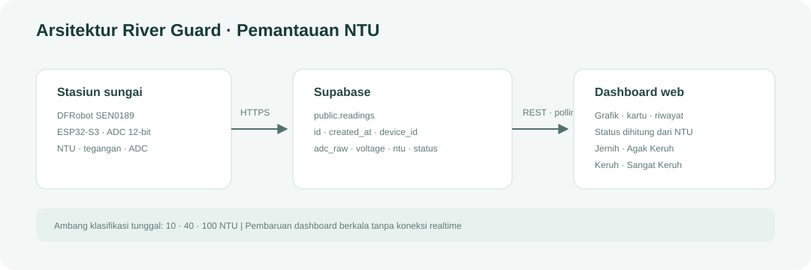

# River Guard

Dashboard IoT untuk pemantauan kekeruhan air sungai menggunakan sensor DFRobot SEN0189 dan ESP32-S3. Data disimpan di Supabase dan ditampilkan dalam satuan NTU.

## Arsitektur



## Alur sistem

1. Sensor menghasilkan tegangan analog yang dibaca melalui ADC ESP32-S3.
2. Perangkat mengirim `device_id`, `adc_raw`, `voltage`, `ntu`, dan `status` ke tabel `public.readings`.
3. Dashboard mengambil data melalui REST Supabase dengan polling berkala.
4. Status di dashboard dihitung dari NTU; kolom `status` menjadi cadangan jika nilai NTU tidak tersedia.

## Klasifikasi NTU

Ambang, label, dan warna didefinisikan bersama di [app/turbidity.ts](./app/turbidity.ts).

| Status | Rentang |
|---|---:|
| Jernih | ≤ 10 NTU |
| Agak Keruh | > 10 sampai 40 NTU |
| Keruh | > 40 sampai 100 NTU |
| Sangat Keruh | > 100 NTU |

Klasifikasi bersifat indikatif berdasarkan literatur kekeruhan air sungai (NTU), bukan baku mutu resmi.

## Struktur database

Tabel `public.readings` menggunakan kolom:

| Kolom | Tipe | Keterangan |
|---|---|---|
| `id` | bigint | ID pembacaan |
| `created_at` | timestamptz | Waktu pembacaan |
| `device_id` | text | Identitas perangkat |
| `adc_raw` | integer | Nilai ADC, 0–4095 |
| `voltage` | numeric | Tegangan sensor dalam volt |
| `ntu` | numeric | Kekeruhan dalam NTU |
| `status` | text | Salah satu dari empat status klasifikasi |

Indeks `(device_id, created_at desc)` disarankan untuk pencarian data perangkat terbaru. Atur Row Level Security dan kebijakan akses sesuai kebutuhan proyek.

## Menjalankan dashboard

Isi `.env.local` dengan konfigurasi Supabase:

```env
NEXT_PUBLIC_SUPABASE_URL=https://<project-ref>.supabase.co
NEXT_PUBLIC_SUPABASE_ANON_KEY=<publishable key>
```

Lalu jalankan:

```bash
npm install
npm run dev
```

Tanpa konfigurasi tersebut, dashboard menggunakan data simulasi. Interval polling adalah 3 detik; riwayat diambil dengan urutan terbaru lebih dahulu dan maksimal 1000 baris.

## Perangkat

- ESP32-S3 dengan ADC 12-bit.
- DFRobot SEN0189 dengan keluaran analog.
- Pembagi tegangan untuk menjaga masukan ADC dalam rentang aman.

Kalibrasi tegangan ke NTU perlu disesuaikan dengan sensor dan lokasi pemasangan. Lindungi komponen elektronik, pasang probe pada posisi yang konsisten, dan bersihkan probe secara berkala.

## Pemeriksaan

```bash
npm run lint
npm run build
```
